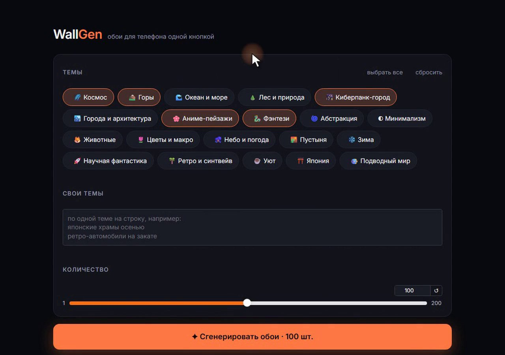
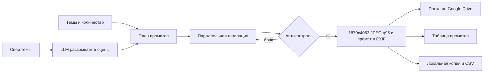
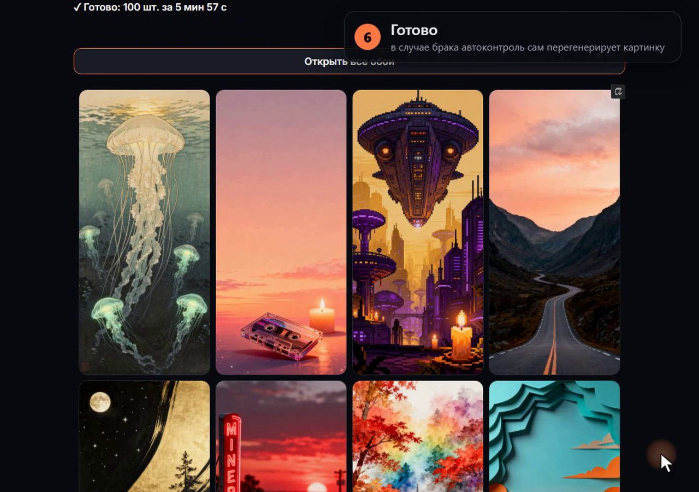
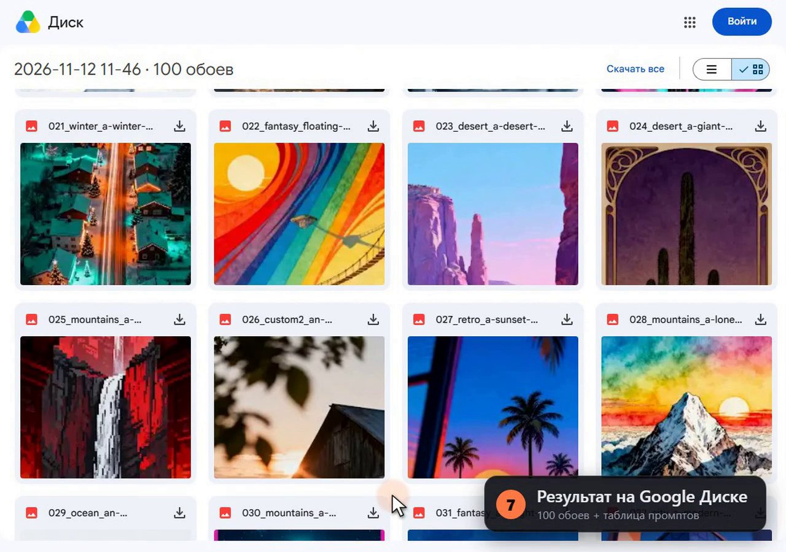
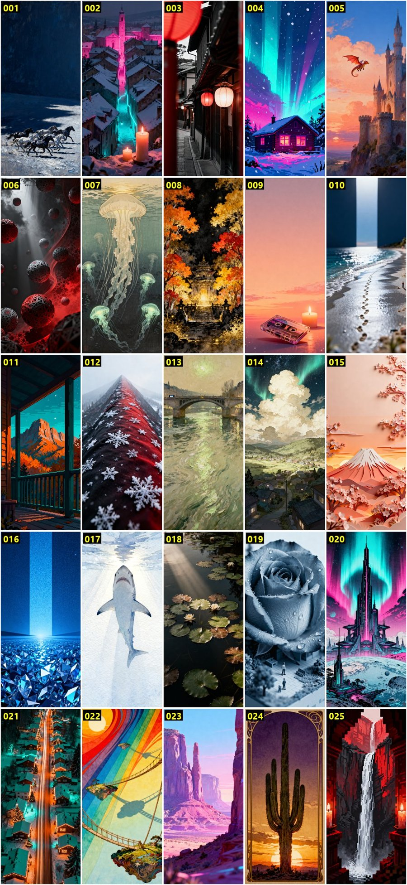

# WallGen

Генерирует пачку уникальных обоев для телефона одной кнопкой, сам проверяет брак и складывает результат в Google Drive вместе с таблицей промптов.



## Задача

Приложению с обоями нужно много картинок в одном формате, разных по сюжету и стилю. Если генерировать их вручную, уходит много времени на промпты, перебор неудачных вариантов и выгрузку. Кроме того, через месяц сложно понять, каким промптом сделана конкретная картинка.

WallGen закрывает весь путь от выбора тем до готовой папки. Каждая картинка получает точный размер 1870 × 4063 и сохранённый промпт.

## Как работает

1. **План промптов.** Пользователь выбирает темы (20 готовых) и при желании пишет свои на любом языке. Каждый промпт собирается из сюжета темы, стиля, композиции, палитры, света и настроения. Значения выбираются по очереди из перемешанных списков, поэтому стили и палитры распределяются по заказу равномерно и не повторяются, пока не закончится список.
2. **Раскрытие своих тем.** Фразу вроде «японские храмы осенью» LLM превращает в 12 разных сцен. Иначе все картинки темы были бы про одно и то же.
3. **Генерация.** До 24 запросов параллельно. Сервис генерации подключён через адаптер и меняется одной строкой в `.env`.
4. **Автоконтроль качества.** Каждую картинку проверяет vision-модель. Она ищет рамку телефона или мокап, декоративную рамку, заметный текст и водяные знаки, повёрнутую набок сцену, склейку из кусков, пустой кадр. Брак перегенерируется с новым seed, до 2 раз.
5. **Приведение к формату.** Обрезка под пропорцию, точный размер, JPEG quality 95, промпт в метаданных EXIF. Если модель выдала картинку меньше нужной, включается апскейл Real-ESRGAN на локальной видеокарте.
6. **Сохранение.** На Google Drive создаётся папка заказа. Файлы загружаются параллельно, промпт пишется в описание каждого файла и в Google-таблицу. Локально остаются копии, `registry.csv` и `prompts.json`.



**Устойчивость к сбоям.** При перегрузке сервиса или обрыве сети запрос повторяется с растущей паузой, до 6 попыток. Если картинки не удались, конвейер догенерирует их до заказанного количества. Если на счёте сервиса нет денег, заказ останавливается с понятным сообщением. Сбой таблицы или загрузки на Drive не теряет уже оплаченные картинки.

## Стек

| Что | Зачем |
|---|---|
| **Seedream 4.0** через gen-api.ru | Основная модель. Сразу генерирует нужное разрешение (1872 × 4064) без апскейла, цена не зависит от размера, картинка готова за 15–30 секунд. Выбрана после сравнения с FLUX.2 dev и klein, Leonardo Lucid Origin, FLUX.1 schnell и Pollinations |
| **FLUX.2 klein 4B** через Cloudflare Workers AI | Бесплатный режим, около 48 картинок в сутки в рамках бесплатной квоты |
| **gpt-4o-mini** через gen-api.ru | Vision-проверка брака и раскрытие своих тем. Запасная LLM для тем это Llama 3.3 70B на Cloudflare |
| **Real-ESRGAN** (ncnn-vulkan) | Апскейл на видеокарте для моделей с меньшим разрешением. Чище, чем обычный ресайз с резкостью |
| **Gradio** | Веб-интерфейс на localhost без отдельного фронтенда |
| **Google Drive API и Sheets API** | Хранилище результата и реестр промптов. Используется scope `drive.file`, приложение видит только созданные им файлы |
| **Pillow** | Обрезка, ресайз, JPEG и EXIF |
| **Playwright и ffmpeg** | Автоматическая запись демо-видео (`record_demo.py`) |

## Результат

Финальный прогон на 100 обоях, 20 тем плюс 2 свои.

- 100 обоев готовы за 5 минут 57 секунд при 12 параллельных потоках.
- После ручного просмотра без брака оказались 87 из 100. Без автоконтроля чистых было бы около двух третей.
- После прогона автоконтроль дообучен промптом на новых видах брака. На выборке из 13 бракованных и 17 чистых картинок он поймал 11 из 13 и ошибочно забраковал 1 из 17.

Экран после завершения заказа:



Папка заказа на Google Drive:



Первые 25 обоев из прогона, без отбора. Видно и брак, который ушёл от автоконтроля, например декоративная рамка на 024.



## Как запустить

### Требования

- Windows (скрипт запуска и апскейлер собраны под Windows, ядро на Python кроссплатформенное)
- Python 3.11 или новее
- Аккаунт gen-api.ru с балансом или аккаунт Cloudflare для бесплатного режима
- Проект в Google Cloud с включёнными Drive API и Sheets API и OAuth-клиентом типа Desktop app
- По желанию видеокарта с поддержкой Vulkan для апскейла

### Установка

```bash
git clone https://github.com/alesya-mmaker/ai-wallpaper-pipeline.git
cd ai-wallpaper-pipeline
python -m venv .venv
.venv\Scripts\python -m pip install -r requirements.txt
```

### Настройка

1. Скопируйте `.env.example` в `.env` и впишите ключи. Каждая переменная описана в комментарии.
2. Скачайте OAuth-клиент Google (Desktop app) в формате JSON и положите в папку проекта как `client_secret.json`.
3. При первом запуске откроется окно входа в Google. После входа рядом появится `token.json`, повторно входить не нужно.
4. Апскейл нужен только для моделей Cloudflare. Скачайте `realesrgan-ncnn-vulkan` для Windows из [релизов Real-ESRGAN](https://github.com/xinntao/Real-ESRGAN/releases) и распакуйте в `tools/realesrgan/`. Без него картинка просто растягивается через Lanczos.

### Запуск

Интерфейс в браузере (двойной клик тоже работает):

```bash
start.bat
```

Из командной строки:

```bash
python run_order.py --themes space mountains anime --count 8
```

```bash
python run_order.py --themes ocean --custom "японские храмы осенью" --count 10 --provider cloudflare:flux-2-klein-4b
```

Список тем и моделей:

```bash
python run_order.py --list
```

Проверка связи с Google Drive и Sheets лежит в `check_google.py`.

## Ограничения и что улучшить

- Автоконтроль ловит не всё. На контрольной выборке он пропускает примерно каждый седьмой брак, тонкие рамки и склейки иногда проходят. Следующий шаг это набор размеченных примеров и сравнение нескольких vision-моделей.
- Нет проверки похожести внутри заказа, две почти одинаковые картинки возможны.
- Это локальное приложение для одного пользователя. Для команды нужен сервер с очередью задач и авторизацией.
- Результат привязан к Google Drive. Хранилище стоит вынести в адаптер, так же как сервис генерации.
- Нет автотестов. Сбои проверялись вручную на поддельных провайдерах.

---

Проект создан в работе с Claude Code.
